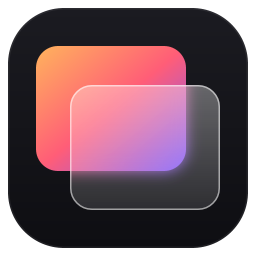

<p align="center">
  
</p>

<h1 align="center">Backdrop</h1>

<p align="center">Lightweight live wallpapers for Windows.</p>

---

Backdrop plays videos, animated GIFs and HTML pages behind the desktop icons. Still images are passed to
the operating system as a regular wallpaper, so they use no resources once set.

The app is built on [Tauri 2](https://tauri.app) and uses the system WebView instead of a bundled browser.
The Windows build is about 5 MB installed, from a 2 MB installer.

## Features

- Video (MP4, WebM, MOV), animated GIF and HTML/canvas/WebGL wallpapers rendered behind the desktop icons
- Still images (JPG, PNG, WebP and others) set through the native wallpaper API
- A separate wallpaper per display, or one across all displays
- Fill, fit, fit-height, stretch and center scaling; playback speed from 0.5× to 2×; optional audio
- A full-resolution frame of each moving wallpaper is set as the Windows wallpaper, so the desktop matches
  it before Backdrop starts
- Rotation on a timer (in order or shuffled, the same or different on each display), plus a random pick at
  startup or after waking from sleep, and a *Next wallpaper* item in the tray menu
- Automatic pause when a window covers the wallpaper, when another app is in front, on battery, with
  battery saver on, and while the screen is locked
- Resolution badges (4K, 1440p, 1080p) and codec details for each item, with a warning on HEVC and ProRes
  files, which Windows can't play
- A Workshop tab for browsing video and HTML wallpapers from the Wallpaper Engine Steam Workshop, with
  anime left out; Steam downloads them in the background and Backdrop adds them to the library
- Drag-and-drop import; HTML wallpapers can be a folder with an `index.html`, a `.zip` of one, or a single
  `.html` file
- Interface in English, Spanish, German and Simplified Chinese
- Runs from the system tray with the main window closed, and can start at login

## Requirements

Windows 10 or 11 with WebView2 (preinstalled on Windows 11).

## Installation

Download `Backdrop_<version>_x64-setup.exe` from [Releases](https://github.com/anthonyradke/backdrop/releases)
and run it. Builds are not code-signed, so SmartScreen warns on first launch; choose
*More info* > *Run anyway*. The installer is per-user and needs no administrator rights.

### Updates

Backdrop checks this repo's releases when it starts and every six hours. The round button next to the status
pill in the title bar checks on demand; when a new version exists it turns green and reads *Update*, and the
tray menu gets an *Update to Backdrop x.y.z* item. Either one downloads the installer, verifies its
signature, installs it and restarts Backdrop. The library and settings are kept.

## Architecture

```
app/
  src-tauri/   desktop app (Rust); common.rs has the item types, ids and zip packing for HTML wallpapers
  ui/          library window and player page; plain HTML, CSS and JavaScript with no build step;
               translations in i18n.js
scripts/       Windows build script
```

### Desktop app

Each display showing a moving wallpaper gets one borderless WebView window that plays it with hardware
video decoding. A one-second engine loop (`engine.rs`) assigns players to displays, applies native image
wallpapers, and handles pausing.

#### Desktop attachment (`platform/windows.rs`)

The player window is reparented into Explorer's desktop window, below the icons. Before Windows 11 24H2 this is the `WorkerW` window Explorer creates in response to
message `0x052C`. On 24H2 and later, with the raised desktop, the player becomes a layered child of
`Progman` placed beneath `SHELLDLL_DefView`, the same approach used by Lively Wallpaper. If Explorer
restarts, players are recreated automatically.

#### Media delivery (`media.rs`, `loopback.rs`)

Files reach the player through a custom `media://`
protocol with HTTP range support. If a WebView cannot play video through that protocol, the player falls
back to a loopback HTTP server bound to `127.0.0.1` on a random port, with a per-session secret token in
the request path.

#### Rotation (`rotation.rs`)

A background task checks the interval every 20 seconds. Picks come from the items marked for rotation, or
from the whole library when none are marked. The engine treats a gap of more than 30 seconds between ticks as a wake from sleep.

#### Steam Workshop (`workshop.rs`)

Browsing reads the public workshop page for item ids and gets titles, previews and tags from Steam's
`GetPublishedFileDetails` API, which needs no key. Requests go through the `curl` that ships with
Windows. Only video and HTML items are shown, since Backdrop can't play Wallpaper Engine scenes.

Anime is filtered in three steps: the query asks for the "Everyone" rating and excludes the genre tags
that turned out to be mostly anime (or memes) when sampled, items need one of the remaining genres and
no anime words (English, Chinese or Japanese) in the title or description, and anything that still slips
through can be hidden by item or by creator.

Workshop files can only be downloaded by someone who owns Wallpaper Engine, so Steam does the
downloading. *Download* works the way Wallpaper Engine does (`steamapi.rs`): a short-lived helper
(`backdrop.exe --steam-download <id>`) loads Wallpaper Engine's own `steam_api64.dll`, subscribes through
the running Steam client and reports progress until the download finishes, so no Steam window opens.
Steam shows Wallpaper Engine as running while the helper is alive. If Steam isn't running, or Wallpaper
Engine isn't installed, Backdrop opens the item in the Steam client to subscribe there instead. Once Steam
has put the item in `steamapps/workshop/content/431960/`, Backdrop imports it, hard-linked when it's on
the same drive so it takes no extra space. The *Downloaded in Steam* view lists earlier subscriptions to
add by hand.

#### Item identity

Each item is identified by the first 16 hex characters of its SHA-256 hash, so adding the same file
twice is caught without extra bookkeeping. Items live in the library folder as `<id>/` with a
`meta.json`, the media file and, for video and images, a `thumb.jpg` the library window renders.

## Building from source

Requires a recent stable Rust toolchain.

### Windows app (cross-compiled from Linux)

The Windows app is built on Linux with [cargo-xwin](https://github.com/rust-cross/cargo-xwin):

```sh
rustup target add x86_64-pc-windows-msvc
cargo install --locked cargo-xwin tauri-cli
sudo apt install nsis lld clang
scripts/build-windows.sh        # output: dist/Backdrop_<version>_x64-setup.exe
```

The installer is signed for the updater, so a release build needs the signing key in
`TAURI_SIGNING_PRIVATE_KEY` and its password in `TAURI_SIGNING_PRIVATE_KEY_PASSWORD`.

### Releases

Releases are built by GitHub Actions (`.github/workflows/release.yml`). `scripts/release.sh X.Y.Z` takes
the list in `UNRELEASED.md` as the release notes, bumps the version, tags and pushes; CI builds, signs and
publishes the installer with the `latest.json` the in-app updater reads, and the update button shows the
notes.

### Development

```sh
cd app/src-tauri && cargo tauri dev
```

On Linux the app runs in a plain window (`platform/other.rs`) for development only.

### Tests

```sh
cargo test --workspace
```

## Known limitations

- WebView2 cannot decode HEVC/H.265 or ProRes. Use H.264, VP9 or AV1 (HandBrake converts
  to H.264).
- The still frame covers the desktop wallpaper only. The lock screen keeps its own image.
- With mixed display scaling, the player on a secondary display renders at the primary display's
  scale. Video still fills the screen but may appear slightly softer.
- HTML wallpapers cannot be paused externally. The player posts `{ backdrop: { paused, muted, volume, speed } }`
  to the page; pages that listen for this message can stop their own animation loop.
- Codec detection reads MP4 and MOV headers only; other formats show no codec.
- Workshop downloads need Steam and a copy of Wallpaper Engine, which has to stay installed (it doesn't have
  to run). The anime filter relies on how uploaders tag and title their items, so some still get through.

## License

[MIT](LICENSE)
