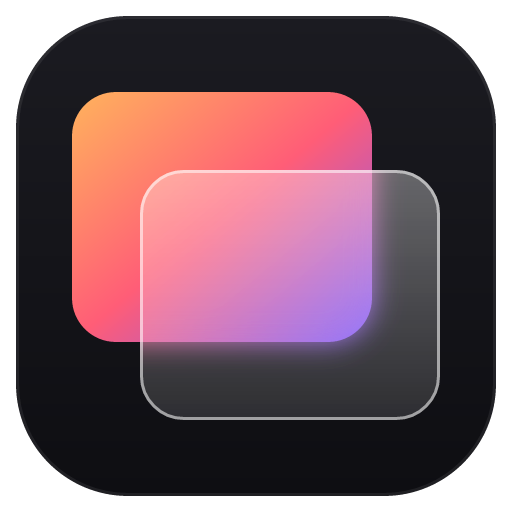
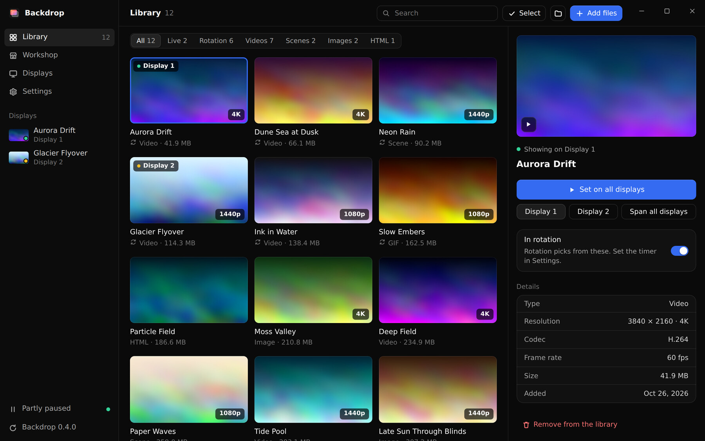
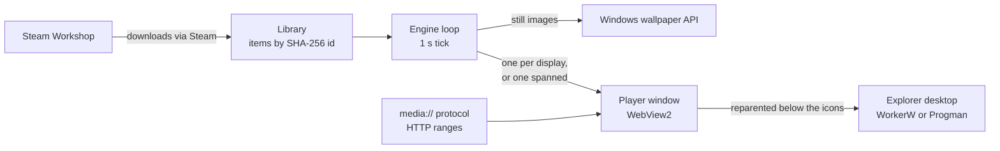

<p align="center">
  
</p>

<h1 align="center">Backdrop</h1>

<p align="center">Live wallpapers for Windows: video, GIF, HTML and Wallpaper Engine scenes behind the desktop icons.</p>

<p align="center">
  
  
  
</p>

Backdrop plays videos, animated GIFs, HTML pages and Wallpaper Engine scenes behind the desktop icons. It is built
on Tauri 2 and renders in the system WebView2 instead of a bundled browser, so it is about 5 MB installed, from a
2 MB installer. Still images are handed to Windows as a regular wallpaper and cost nothing once set.

<p align="center">
  
</p>

## Features

Wallpapers
- Video (MP4, WebM, MOV), animated GIF and HTML, canvas or WebGL pages.
- Wallpaper Engine scenes (`scene.pkg`) rendered with WebGL2: image layers, shader effects, puppets, particles,
  text, audio visualizers and SceneScript.
- Still images (JPG, PNG, WebP and others) set through the native wallpaper API.
- Import by drag and drop. An HTML wallpaper can be a folder with an `index.html`, a `.zip` of one, or a single
  `.html` file.
- The settings a scene or HTML wallpaper declares (colours, sliders, switches, lists) can be changed in the
  library. HTML wallpapers get Wallpaper Engine's web API: properties, audio levels and what's playing.

Displays and playback
- A separate wallpaper per display, the same one on every display, or one spanned across all of them.
- Fill, fit, fit-height, stretch and center scaling, playback speed from 0.5× to 2×, optional audio.
- Playback pauses when a window covers the wallpaper, when another app is in front, on battery, with battery
  saver on, and while the screen is locked. Chosen programs (a game, a screen recorder) can pause or mute
  the wallpapers while they run.
- A full-resolution frame of each moving wallpaper is set as the Windows wallpaper, so the desktop matches before
  Backdrop starts.
- Rotation on a timer, in order or shuffled, with a random pick at startup or after waking from sleep. With a
  different wallpaper on each display, a display can have its own list.
- A schedule: at set times of day, a chosen wallpaper on all displays or on one.

Library
- A grid with resolution badges and codec details, and a warning on HEVC and ProRes files, which WebView2 can't
  play.
- Multi-select for deleting wallpapers or changing their rotation in bulk.
- A Workshop tab that browses the Wallpaper Engine Steam Workshop by genre and adds items to the library. Steam
  does the downloading, and updates it downloads later replace the library's copy. Anime is filtered out of
  browsing, and single items or creators can be hidden.

App
- Runs from the system tray with the window closed, and can start at login.
- Signed updates from this repo's releases, installed from the title bar or the tray.
- Interface in English, Spanish, German and Simplified Chinese.

## Requirements

- Windows 10 or 11 with WebView2, which Windows 11 includes.
- For scenes and the Workshop tab: Steam and an installed copy of Wallpaper Engine. Scenes read its stock shaders
  and effects, and Steam only serves Workshop files to accounts that own it. Video, GIF, HTML and image
  wallpapers need neither.

## Install

Download `Backdrop_<version>_x64-setup.exe` from [Releases](https://github.com/anthonyradke/backdrop/releases) and
run it. The installer is per-user and needs no administrator rights. It isn't code-signed, so SmartScreen asks on
first launch: choose More info, then Run anyway.

Backdrop checks for a new release at startup and every six hours. Updating downloads the installer, verifies its
signature, installs it and restarts, keeping the library and settings.

## How it works



- Each display with a moving wallpaper gets one borderless WebView2 window with hardware video decoding. The
  window is reparented into Explorer's desktop window below the icons: the `WorkerW` window before Windows 11
  24H2, and a layered child of `Progman` from 24H2 on. Players are recreated if Explorer restarts.
- A spanned wallpaper uses a single window over the rectangle around all displays, so it needs one decoder and
  stays in sync.
- Files reach the player through a custom `media://` protocol with HTTP range support, with a loopback HTTP
  server as the fallback. HTML wallpapers run on the loopback server's origin in a sandboxed frame, so
  they can't call the app's commands.
- Scenes are unpacked from `scene.pkg` and rendered in the player page. The renderer reads Wallpaper Engine's
  texture and model formats, translates its shaders to GLSL ES 3.00 and runs SceneScript in a Worker with no
  network access.
- Workshop downloads go through the running Steam client using Wallpaper Engine's own Steam API library. A
  downloaded video is hard-linked into the library, so it takes no extra space on the same drive.

[docs/architecture.md](docs/architecture.md) covers each of these in detail.

## Build from source

The Windows app is cross-compiled on Linux with [cargo-xwin](https://github.com/rust-cross/cargo-xwin).

```sh
rustup target add x86_64-pc-windows-msvc
cargo install --locked cargo-xwin tauri-cli
sudo apt install nsis lld clang
scripts/build-windows.sh         # dist/Backdrop_<version>_x64-setup.exe
cargo test --workspace
```

A release build needs the updater signing key. [docs/development.md](docs/development.md) covers signing,
releases and running the app locally.

## Layout

| Path | Contents |
|---|---|
| `app/src-tauri/src/engine.rs` | Assigns players to displays, applies image wallpapers, handles pausing |
| `app/src-tauri/src/platform/` | Desktop attachment on Windows, and a plain window on Linux for development |
| `app/src-tauri/src/scene.rs`, `audio.rs` | Scene unpacking, and frequency bands from WASAPI loopback for visualizers |
| `app/src-tauri/src/media.rs`, `loopback.rs` | The `media://` protocol and its HTTP fallback |
| `app/src-tauri/src/workshop.rs`, `steamapi.rs` | Workshop browsing and downloads through Steam |
| `app/src-tauri/src/rotation.rs`, `library.rs` | Rotation timer and the library on disk |
| `app/ui` | Library window and player page: plain HTML, CSS and JavaScript with no build step |
| `app/ui/scene/` | The WebGL2 scene renderer |
| `scripts/` | Windows build and release scripts |

## Known limitations

- WebView2 can't decode HEVC or ProRes. Use H.264, VP9 or AV1.
- Scenes run at 30 fps with simple point lighting. Application wallpapers aren't supported, because they would
  mean running downloaded programs.
- The still frame covers the desktop wallpaper only; the lock screen keeps its own image.
- With mixed display scaling, the player on a secondary display renders at the primary display's scale, so video
  can look slightly softer there.
- A spanned still image uses the Windows Span position, which ignores the Fit setting.
- HTML wallpapers can't be fully paused from outside. Pausing stops their audio and video elements, and the
  player posts `{ backdrop: { paused, muted, volume, speed } }` to the page so it can stop its own animation
  loop.
- Codec detection reads MP4 and MOV headers only.

## Credits

Backdrop is not affiliated with Wallpaper Engine or Valve. The desktop attachment on Windows 11 24H2 follows the
approach used by [Lively Wallpaper](https://github.com/rocksdanister/lively).

## License

MIT. See [LICENSE](LICENSE).
